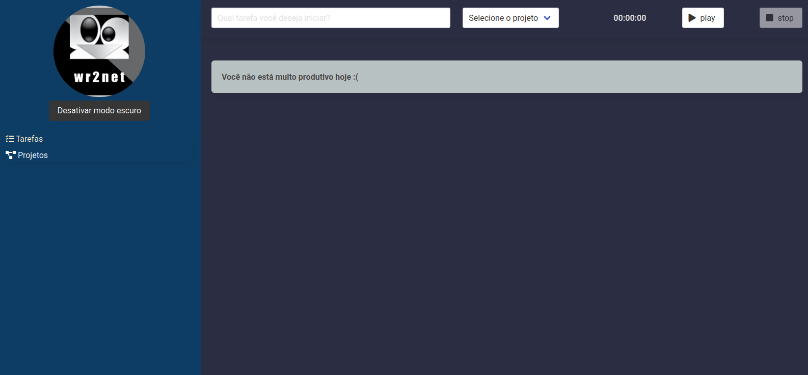
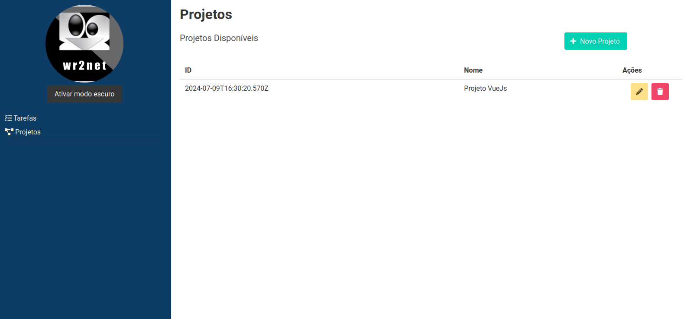
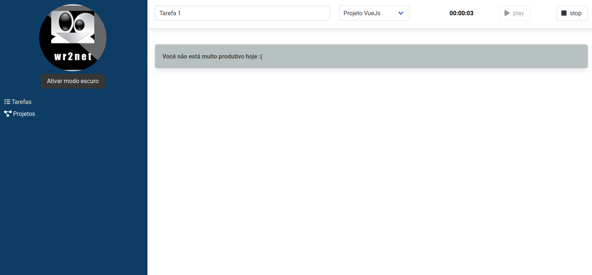
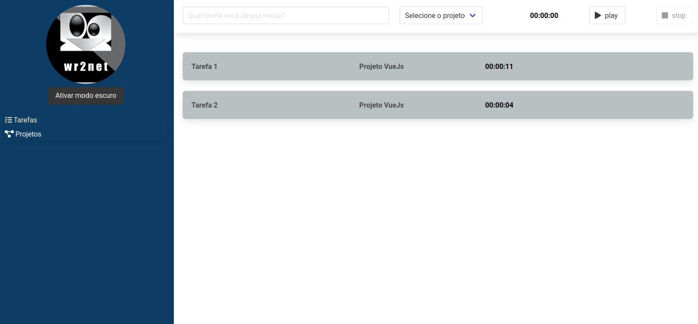

# wr2-tracker

### This study project was developed with VueJs with the aim of recording effort time in project development tasks.







### View in production
[https://tracker.fawacom.com.br/](https://tracker.fawacom.com.br/)

# Instructions

## Project setup
```bash
yarn install
```

### Compiles and hot-reloads for development
```bash
yarn serve
```

### Compiles and minifies for production
```bash
yarn build
```

### Lints and fixes files
```bash
yarn lint
```
